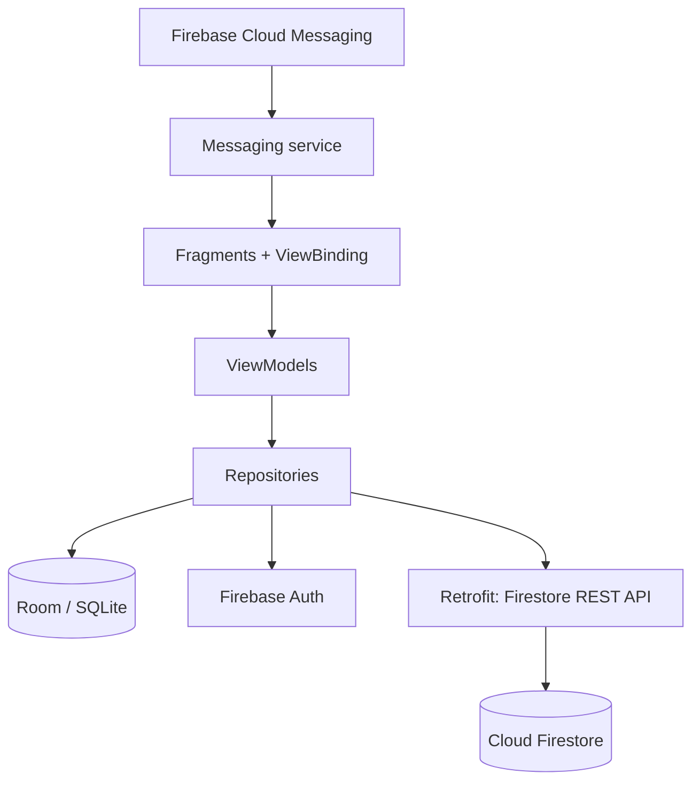
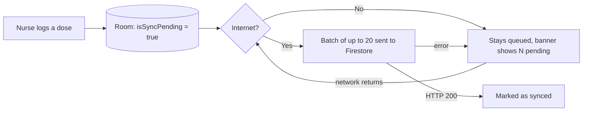

<h1 align="center">🏥 WardCare</h1>

<b>A bedside assistant for ward nurses, built to keep working when the Wi-Fi doesn't.</b>

  
  
  
  

**Team (Group 19):** Tiyase Ntesheng (ST10445279) · Mabelebele Maselelo (ST10436039)
**Video demo:** _add link here_ · **Download the APK:** [Releases](https://github.com/st10445279/WardCare/releases)

> All patient data in this project is fictional. WardCare is **not** a clinical decision-support tool: it gives no dosage advice and does no drug-interaction checking.

## Contents
1. [Purpose of the app](#1-purpose-of-the-app) · 2. [Screenshots](#2-screenshots) · 3. [Features](#3-features-mapped-to-the-brief) · 4. [Design considerations](#4-design-considerations) · 5. [Innovative features](#5-innovative-features) · 6. [GitHub and GitHub Actions](#6-use-of-github-and-github-actions) · 7. [Testing](#7-testing-and-logging) · 8. [Running the app](#8-running-the-app) · 9. [Release notes](#9-release-notes) · 10. [Limitations](#10-known-limitations) · 11. [References](#11-references)

## 1. Purpose of the app

**The problem.** On many wards, medication and patient tracking is still done on paper. That is slow and easy to get wrong, nurses already carry heavy workloads, and ward Wi-Fi is unreliable, so a purely online app fails exactly when it is needed.

**The idea.** WardCare is a digital bedside assistant. A nurse can look up a patient, log a dose as *given*, *missed* or *delayed*, and see ward alerts. Everything works with no connection, and the app syncs to the cloud as soon as the network returns.

**Who it is for and the value it gives.**

| Users | Value |
|---|---|
| Nurses | Fast dose logging at the bedside, with no paper and no waiting for Wi-Fi |
| Supervisors and doctors | One shared, up-to-date record of what was given, missed or delayed |
| Everyone | An interface in English, isiZulu and Afrikaans |

## 2. Screenshots

  
  
  

  
  
  

**Behind the scenes:** the same data in the cloud, and the automated pipeline.

  
  

## 3. Features (mapped to the brief)

| Requirement | How WardCare meets it |
|---|---|
| Register and log in, password encrypted | Firebase Authentication. The app never stores the password, and Firebase keeps only a salted hash. |
| Single sign-on | Google Sign-In, exchanged for a Firebase session |
| Change settings | Staff profile, ward, language and notification switch |
| REST API connected to a database | Cloud Firestore through its **REST API**, called with Retrofit |
| Offline mode with sync | Room stores everything locally. Queued logs sync in atomic batches. |
| Real-time notifications | Firebase Cloud Messaging push alerts plus an in-app alert list |
| Multi-language (2+ SA languages) | English, isiZulu and Afrikaans, switched at runtime |
| Handles invalid input | Validation on every form, with clear errors and no crashes |
| Icon and image assets | Custom launcher icon and navigation icons |

## 4. Design considerations

### Architecture
MVVM with the Repository pattern. Room is the single source of truth, so the UI always reads local data and the network only keeps it fresh.

### Offline-first sync

A log is only marked as synced after the server confirms it. Each batch is atomic, and writes use the log's own id, so retries can never create duplicates.

### UI/UX
Material 3 cards, a calm clinical blue palette, large tap targets for gloved or hurried use, and colour-coded status badges (given, missed, delayed). Banners show how many entries are waiting to sync and the newest alert.

### Security
- Passwords are never stored in the app. Firebase Authentication keeps only a salted hash, and passwords travel over TLS.
- Every REST call carries the signed-in user's Firebase ID token. Firestore rules allow only signed-in staff, and a user can only read or write their own profile and push token.
- Logs and the HTTP logger never contain passwords, tokens or patient details.

### Localisation
`AppCompatDelegate.setApplicationLocales` switches between English, isiZulu and Afrikaans instantly, without restarting the app.

### Error handling
`InputValidator` checks email, password strength, name and phone before anything is sent. Network and authentication errors are turned into plain-language messages, and a failed sync leaves data queued instead of losing it.

## 5. Innovative features

1. **Offline-first medication logging with automatic sync.** Nurses never wait for a connection. Logs queue locally, a banner shows what is pending, and the app syncs on its own the moment the network is back, in atomic batches of 20.
2. **Real-time ward alerts with push notifications.** Alerts reach every nurse through Firebase Cloud Messaging, even when the app is closed. They are also kept in an in-app alert list.
3. **Real single sign-on.** One tap with Google, backed by a Firebase session, plus a secure email link for password reset.
4. **Trilingual interface at runtime.** Staff can switch between English, isiZulu and Afrikaans from Settings, with no restart.

## 6. Use of GitHub and GitHub Actions

**Version control.** The project lives in this repository, which was initialised with a README. Work is committed in small, descriptive steps and pushed regularly, for example *"Add Firebase Auth, Firestore REST sync and FCM push notifications"*, *"Add unit tests and run them in GitHub Actions"* and *"Update README for final PoE"*. The final submission commit is tagged **`final-poe`**, and the release is published as **`v1.0.0`**.

**Releases.** The signed-off debug APK and these release notes are attached to the [v1.0.0 release](https://github.com/st10445279/WardCare/releases).

**GitHub Actions CI.** The workflow in [`.github/workflows/android.yml`](.github/workflows/android.yml) runs on every push and pull request to `main`, so the app is built somewhere other than a developer's laptop:

| Step | What it does |
|---|---|
| Checkout | Pulls the code |
| Set up JDK 17 (Temurin) | Installs Java with Gradle caching |
| `chmod +x gradlew` | Makes the Gradle wrapper executable on Linux |
| `./gradlew testDebugUnitTest` | Runs all unit tests |
| Upload test report | Saves the HTML report as an artifact, even when tests fail |
| `./gradlew assembleDebug` | Builds the debug APK |
| Upload APK | Saves `app-debug.apk` as a downloadable artifact |

## 7. Testing and logging

**Automated tests** (`app/src/test`, JUnit 4):
- `InputValidatorTest`: email, password, name and phone rules.
- `FirestoreMapperTest`: converting logs and patients to and from Firestore JSON, including edge cases.
- `MedicationRepositoryTest`: the offline queue. A log is saved offline and stays queued, server errors keep data queued, and 45 pending logs are sent as batches of 20, 20 and 5.

**Logging.** `android.util.Log` is used across authentication, repositories, sync, database seeding and push handling. In Logcat, filter by tags such as `AuthViewModel`, `UserRepository`, `MedicationRepository`, `PatientRepository`, `AppDatabase`, `MainActivity` and `WardCareMessaging`.

## 8. Running the app

1. Clone the repository and open it in Android Studio (JDK 17). `app/google-services.json` is included.
2. Run on an emulator with Google Play services, or on a phone (Android 7.0+).
3. To use Google sign-in from your own machine, add your debug SHA-1 to the Firebase project.
4. To demo push alerts: Firebase console → Messaging → new campaign → Notification → target the topic `ward-alerts`.

**Tech stack:** Kotlin, AndroidX (ViewBinding, Navigation, Lifecycle), Material 3, Room, Retrofit, OkHttp, Gson, Coroutines, Firebase Auth, Firestore (REST), Firebase Cloud Messaging, Google Sign-In, JUnit 4, GitHub Actions. Min SDK 24, target SDK 35.

## 9. Release notes

### v1.0.0: Final PoE (November 2026)

**New in this version, compared with the prototype**

| Area | Prototype | v1.0.0 |
|---|---|---|
| Login and registration | Simulated: any non-empty login succeeded and no real account was created | ✨ Real accounts with Firebase Authentication and a salted password hash |
| Google single sign-on | A button that marked the user as logged in | ✨ Real Google Sign-In, exchanged for a Firebase session |
| Password reset | A toast message | ✨ A real reset link emailed by Firebase |
| Backend | A placeholder URL that did not exist | ✨ Cloud Firestore through its REST API, secured with security rules |
| Sync | Logs only queued on the device | ✨ Atomic batches of 20, retried safely, and automatic sync when the network returns |
| Notifications | An in-app list only | ✨ Real-time push alerts through Firebase Cloud Messaging |
| Patients and profile | Local only | Stored in the cloud and loaded on any device after login |
| Input validation | Basic checks | Shared `InputValidator` and clear error messages |
| Testing | None | ✨ Unit tests for validation, JSON mapping and the offline queue |
| CI | Build only | ✨ GitHub Actions runs the tests, then builds the APK |
| Logging | None | ✨ Logging across authentication, sync, database and push |
| Documentation | Basic README | Full report, diagrams, screenshots and release notes |
| Demo data | A seeded demo account | Removed. Only fictional patients remain. |

**Innovative features added in this version:** offline-first sync with automatic reconnect, real-time push alerts, real Google single sign-on and email password reset (see [section 5](#5-innovative-features)).

**Carried over from the prototype:** patient list, patient detail and history, medication logging with given/missed/delayed status, local Room storage, settings and profile editing, in-app alert list, and English, isiZulu and Afrikaans language switching.

## 10. Known limitations
- Any signed-in staff member can read and write patient and medication data. Per-ward roles are not implemented yet.
- Push alerts are sent from the Firebase console, because there is no server of our own to send them automatically.
- A push that arrives while the app is in the background shows in the system tray, but is added to the in-app list only when received in the foreground.

## 11. References
- Cloud Firestore REST API: https://firebase.google.com/docs/firestore/use-rest-api
- Firebase Authentication on Android: https://firebase.google.com/docs/auth/android/start
- Google Sign-In with Firebase: https://firebase.google.com/docs/auth/android/google-signin
- Firebase Cloud Messaging: https://firebase.google.com/docs/cloud-messaging/android/receive
- Room persistence library: https://developer.android.com/training/data-storage/room
- GitHub Actions for Android: https://docs.github.com/actions
